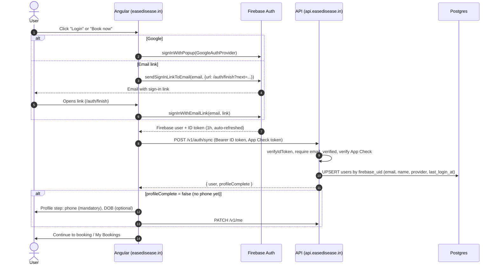
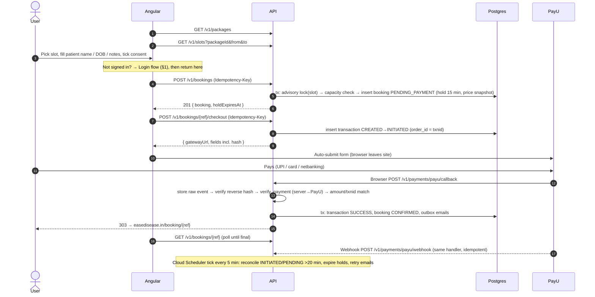

# Ease Disease: Backend API Flow (v1, locked)

Companion to `claude/backend-plan.md` (v3). Base URL `https://api.easedisease.in` (staging: `https://api-staging.easedisease.in`).

---

## 1. Login (locked)

### 1.1 Sign-in methods (Firebase Auth, both free)

| Method | Who it covers | Notes |
|---|---|---|
| **Continue with Google** | Anyone with a Google account: Gmail, Google Workspace work emails, and non-Gmail addresses registered as Google accounts | One tap; email always verified |
| **Email link (passwordless)** | **Any email address** | User enters email → gets a sign-in link → taps it → signed in. Free up to 25,000 emails/day on Blaze. Email is verified by clicking |

**Not used:**
- **Email + password:** passwords to leak and reset, and the email is unverified until confirmed.
- **Phone OTP:** costs per SMS. It can be added later.

**Account linking:** keep Firebase's default **"one account per email address"**. A user who signs in with Google on Monday and by email link on Friday with the same email lands on the **same Firebase user (same uid)**, so their bookings stay together. QA must check this, including the "account exists with different credential" prompt.

**Email-link UX rules:**
- Store the typed email in `localStorage` before sending the link.
- If the link opens on another device or browser (or inside the Gmail app's in-app browser), ask the user to re-enter their email to finish.
- The link returns to `https://easedisease.in/auth/finish?next=…`, so the user resumes where they were (for example, the booking page).

### 1.2 Flow



**Returning user:** Firebase restores the session on the device automatically. The app calls `GET /v1/me` on load and lands on My Bookings with no prompt. No cookies are involved: every API call carries `Authorization: Bearer <ID token>`.

---

## 2. Booking + payment (locked)



---

## 3. Conventions

| Topic | Rule |
|---|---|
| Versioning | `/v1/...` path prefix |
| Format | JSON, camelCase. Timestamps ISO-8601 UTC (`2026-10-20T05:30:00.000Z`); the UI shows IST. Dates `YYYY-MM-DD` |
| Money | Integer **paise** (`pricePaise: 150000`) + `currency: "INR"`. Format only in the UI |
| Auth header | `Authorization: Bearer <Firebase ID token>`; the token is verified on every request |
| App Check | `X-Firebase-AppCheck: <token>` required on `POST /v1/auth/sync`, `POST /v1/bookings`, `POST /v1/bookings/{ref}/checkout` |
| Idempotency | `Idempotency-Key: <uuid v4>` required on `POST /v1/bookings` and `/checkout`. The same key from the same user within 24 h returns the original response; the same key with a different body returns `409 IDEMPOTENCY_CONFLICT` |
| Tracing | Every response carries `X-Request-Id`, which is also in logs and error bodies |
| Pagination | Cursor based: `?limit=20&cursor=<opaque>` → `{ items, nextCursor }` |
| Errors | `{ "error": { "code": "SLOT_FULL", "message": "Human readable", "details": {}, "requestId": "..." } }`. **The UI branches on `code`.** |
| Ownership | A booking not owned by the caller returns **404** (never 403), so references can't be probed |
| Shared types | All DTOs live in `packages/contracts` and are imported by Angular and Nest |

---

## 4. Endpoints

**Legend:** 🌐 public · 🔐 Bearer token · 🛡️ App Check · 🔁 Idempotency-Key

### Health
**`GET /healthz`** 🌐 → `200 { "status": "ok", "version": "1.0.3", "db": "ok" }`

### Auth & profile

**`POST /v1/auth/sync`** 🔐🛡️. Called right after every sign-in.
- Server:
  1. Verify the ID token.
  2. Require `email_verified = true`.
  3. Upsert the user by `firebase_uid`: email, display name (if empty), `auth_provider` (`google.com` | `emailLink`), `last_login_at`.
- `200`:
```json
{ "user": { "id": "7b1e…", "email": "priya@example.com", "name": "Priya Sharma", "phone": null, "dob": null, "authProvider": "google.com" },
  "profileComplete": false }
```
- Errors: `401 UNAUTHENTICATED`, `403 EMAIL_NOT_VERIFIED`, `403 APP_CHECK_FAILED`.

**`GET /v1/me`** 🔐 → `200 { user, profileComplete }`. If the token is valid but the user row is missing, it is created (same as sync).

**`PATCH /v1/me`** 🔐
```json
{ "name": "Priya Sharma", "phone": "+91 98765 43210", "dob": "1990-04-12" }
```
- Validation:
  - name: 2–100 chars.
  - phone: normalised to E.164; Indian mobile; used as the WhatsApp contact. **Not verified in v1.**
  - dob: past date, age ≤ 120.
- `200 { user, profileComplete }`. **`profileComplete` = name + phone present.**

### Catalog

**`GET /v1/packages`** 🌐. Active packages only; `Cache-Control: public, max-age=300`.
```json
{ "packages": [ { "id": "pkg_…", "slug": "one-time-consult", "title": "One-Time Consult", "description": "…",
                  "pricePaise": 150000, "currency": "INR", "durationMinutes": 30 } ] }
```

**`GET /v1/slots?packageId=…&from=2026-10-20&to=2026-10-26`** 🌐
- Range ≤ 14 days; past slots excluded; slots start at least 2 hours from now.
- Each slot is generated from the availability rules minus blocked dates minus active bookings (`CONFIRMED` + unexpired `PENDING_PAYMENT`).
```json
{ "timezone": "Asia/Kolkata",
  "slots": [ { "start": "2026-10-20T04:30:00.000Z", "end": "2026-10-20T05:00:00.000Z", "available": true } ] }
```
- Errors: `400 VALIDATION_FAILED`, `404 PACKAGE_NOT_FOUND`.

### Bookings

**`POST /v1/bookings`** 🔐🛡️🔁
```json
{ "packageId": "pkg_…", "slotStart": "2026-10-20T04:30:00.000Z",
  "patientName": "Priya Sharma", "patientDob": "1990-04-12", "notes": "Bloating after meals", "consent": true }
```
- Server checks, in order:
  1. `profileComplete`.
  2. Package exists and is active.
  3. `slotStart` is on a slot boundary, inside the rules, and not blocked.
  4. Caller has < 3 upcoming `PENDING_PAYMENT` bookings.
  5. DB transaction: `pg_advisory_xact_lock(slot)` → count active bookings < capacity → insert booking.
- The booking is created with `amount_paise` from the package, `hold_expires_at = now + 15 min` and `consent_at = now`.
- `201`:
```json
{ "booking": { "reference": "ED-7K3QXM", "status": "PENDING_PAYMENT", "packageTitle": "One-Time Consult",
               "slotStart": "…", "slotEnd": "…", "amountPaise": 150000, "currency": "INR",
               "patientName": "Priya Sharma", "holdExpiresAt": "…", "payment": null, "canPay": true } }
```
- Errors:
  - `409 PROFILE_INCOMPLETE`
  - `404 PACKAGE_NOT_FOUND`
  - `400 VALIDATION_FAILED` (`details.fields`)
  - `409 SLOT_FULL`
  - `429 TOO_MANY_PENDING_BOOKINGS`
  - `409 IDEMPOTENCY_CONFLICT`

**`GET /v1/bookings?status=upcoming|past|all&limit=20&cursor=…`** 🔐. **This is My Bookings.**
```json
{ "items": [ { "reference": "ED-7K3QXM", "status": "CONFIRMED", "packageTitle": "One-Time Consult",
               "slotStart": "…", "slotEnd": "…", "amountPaise": 150000, "paymentStatus": "SUCCESS" } ],
  "nextCursor": null }
```

**`GET /v1/bookings/{ref}`** 🔐. Detail; also polled by the payment status page (every 2 s, max 60 s).
```json
{ "booking": { "reference": "ED-7K3QXM", "status": "CONFIRMED", "packageTitle": "…", "slotStart": "…", "slotEnd": "…",
               "amountPaise": 150000, "currency": "INR", "patientName": "…", "patientDob": "…", "notes": "…",
               "holdExpiresAt": null, "canPay": false,
               "payment": { "orderId": "EDTX01JB…", "status": "SUCCESS", "mode": "UPI", "paidAt": "…" } } }
```
- `canPay` = status `PENDING_PAYMENT` and hold still valid.
- Errors: `404 BOOKING_NOT_FOUND` (also when not the owner).

### Payments

**`POST /v1/bookings/{ref}/checkout`** 🔐🛡️🔁
- Preconditions:
  - Booking is owned by the caller and `PENDING_PAYMENT`.
  - Hold is still valid. If it has expired and the slot is still free, the hold is re-taken (new 15 min); otherwise `409 SLOT_NO_LONGER_AVAILABLE` and the booking is marked `EXPIRED`.
  - An `INITIATED` transaction younger than 15 min is **reused** (same fields), so double-clicks don't create double payments.
- Creates the transaction: `order_id` = `EDTX` + ULID (≤ 25 chars, PayU txnid limit), status `INITIATED`, amount from the booking snapshot.
- Hash: `sha512(key|txnid|amount|productinfo|firstname|email|udf1|udf2|udf3|udf4|udf5||||||SALT)`, with amount as `"1500.00"` and `udf1` = booking ref.
- `200`:
```json
{ "gatewayUrl": "https://secure.payu.in/_payment", "method": "POST",
  "fields": { "key": "…", "txnid": "EDTX01JB…", "amount": "1500.00", "productinfo": "One-Time Consult",
              "firstname": "Priya", "email": "priya@example.com", "phone": "9876543210",
              "surl": "https://api.easedisease.in/v1/payments/payu/callback",
              "furl": "https://api.easedisease.in/v1/payments/payu/callback",
              "udf1": "ED-7K3QXM", "hash": "…" } }
```
- The merchant `key` is public by design. **The salt never leaves the server.** Staging returns `https://test.payu.in/_payment`.
- Errors: `404 BOOKING_NOT_FOUND`, `409 BOOKING_NOT_PAYABLE`, `409 SLOT_NO_LONGER_AVAILABLE`.

**`POST /v1/payments/payu/callback`** 🌐. `application/x-www-form-urlencoded` from PayU via the user's browser (surl/furl).
- **Authenticated by hash, not by token** (it is a cross-site form POST).
- **Always** responds `303 Location: https://easedisease.in/booking/{ref}`. Even on a bad hash it goes to `/booking/{ref}?e=verify`, and an event is logged. The page reads the real status from `GET /v1/bookings/{ref}`; **nothing in the URL is trusted**.

**`POST /v1/payments/payu/webhook`** 🌐. Server-to-server from PayU (URL set in the PayU dashboard).
- Same handler; returns `200 {"ok":true}` quickly, also for duplicates.

**Payment handler** (shared by callback, webhook and reconcile; idempotent):
1. Insert the raw payload into `payment_events` (source, received_at).
2. Find the transaction by `txnid`; if unknown → log + stop.
3. Verify the reverse hash: `sha512(SALT|status||||||udf5|udf4|udf3|udf2|udf1|email|firstname|productinfo|amount|txnid|key)` (use the `additional_charges` variant if present). Mismatch → mark the event `hash_valid=false`, stop.
4. Call **PayU `verify_payment`** (`command=verify_payment`, `var1=txnid`, `hash=sha512(key|command|var1|salt)`) and use **its** status as truth.
5. Check the amount equals `amount_paise` and the txnid matches. Mismatch → transaction `FAILURE` + booking `NEEDS_ATTENTION` + admin alert.
6. One DB transaction with guarded transitions (`UPDATE … WHERE status IN (…)`):
   - `success` → transaction `SUCCESS` (mode, mihpayid, bank_ref, completed_at).
     - Slot still held or free → booking `CONFIRMED` + outbox: expert alert + patient confirmation.
     - Slot lost (hold expired and filled) → booking `NEEDS_ATTENTION` + admin alert (refund).
   - `failure` / `cancelled` → transaction `FAILURE` / `CANCELLED`; booking stays `PENDING_PAYMENT` (retry allowed while the hold lasts).
   - `pending` → transaction `PENDING`; the tick re-checks.
7. A replay or a late duplicate changes nothing; the guarded UPDATE affects 0 rows.

### Internal

**`POST /v1/internal/tick`**. Cloud Scheduler every 5 min. Only accepted with a Google-signed OIDC token for the scheduler's service account (audience = API URL).
1. **Reconcile:** transactions `INITIATED` or `PENDING` older than 20 min → `verify_payment` → payment handler. Give up after 24 h → `EXPIRED`.
2. **Expire holds:** `PENDING_PAYMENT` bookings past `hold_expires_at` with no open transaction → `EXPIRED`.
3. **Outbox:** send due emails, with exponential backoff, max 8 attempts, then alert.
4. **Cleanup:** idempotency keys older than 24 h.

---

## 5. State machines

```
Booking:      PENDING_PAYMENT ──pay ok──► CONFIRMED ──► COMPLETED | NO_SHOW | CANCELLED (staff, later)
                    │ hold lapsed, no open payment ──► EXPIRED
                    └ paid but slot lost / amount mismatch ──► NEEDS_ATTENTION ──(staff)──► CONFIRMED | REFUNDED

Transaction:  CREATED ──► INITIATED ──► SUCCESS
                               ├──────► FAILURE | CANCELLED
                               ├──────► PENDING ──(reconcile)──► SUCCESS | FAILURE
                               └──────► EXPIRED (no result after 24 h)
```

## 6. Error codes

| HTTP | code | When |
|---|---|---|
| 400 | `VALIDATION_FAILED` | Bad input; `details.fields` maps field → message |
| 401 | `UNAUTHENTICATED` | Missing, expired or revoked ID token |
| 403 | `EMAIL_NOT_VERIFIED` | Firebase user without a verified email |
| 403 | `APP_CHECK_FAILED` | Missing or invalid App Check token |
| 404 | `PACKAGE_NOT_FOUND` / `BOOKING_NOT_FOUND` | Unknown, inactive or not owned |
| 409 | `PROFILE_INCOMPLETE` | Phone or name missing before booking |
| 409 | `SLOT_FULL` | Capacity reached |
| 409 | `SLOT_NO_LONGER_AVAILABLE` | Hold lapsed and slot taken before checkout |
| 409 | `BOOKING_NOT_PAYABLE` | Not `PENDING_PAYMENT` |
| 409 | `IDEMPOTENCY_CONFLICT` | Same key, different body |
| 429 | `RATE_LIMITED` / `TOO_MANY_PENDING_BOOKINGS` | Throttled, or 3 unpaid bookings already |
| 500 | `INTERNAL` | Unexpected; includes `requestId` |
| 503 | `PAYMENT_GATEWAY_UNAVAILABLE` | PayU unreachable at checkout |

## 7. Rate limits (per instance + DB-backed where it matters)

| Endpoint group | Limit |
|---|---|
| Public GETs (`/packages`, `/slots`) | 60 / min / IP |
| `/auth/sync`, `/me` | 30 / min / user |
| `POST /bookings` | 10 / hour / user (+ max 3 unpaid) |
| `/checkout` | 10 / hour / user |
| PayU callback / webhook | 120 / min / IP (hash-authenticated) |

## 8. Tables touched per endpoint

| Endpoint | Reads | Writes |
|---|---|---|
| auth/sync, me | users | users |
| packages, slots | packages, availability_rules, blocked_dates, bookings | none |
| POST bookings | users, packages, availability_rules, bookings, idempotency_keys | bookings, idempotency_keys |
| checkout | bookings, transactions | transactions, bookings (hold), idempotency_keys |
| callback / webhook / tick | transactions, bookings | payment_events, transactions, bookings, outbox |
