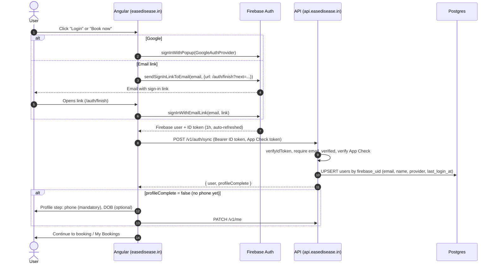

# Ease Disease: Backend API Flow (v1, locked; revised 2026-10-21: no slots, assessment-form bookings, count caps)

Companion to `claude/backend-plan.md` (v3). Base URL `https://api.easedisease.in` (staging: `https://api-staging.easedisease.in`).

---

## 1. Login (locked)

### 1.1 Sign-in methods (Firebase Auth, both free)

| Method | Who it covers | Notes |
|---|---|---|
| **Continue with Google** | Anyone with a Google account: Gmail, Google Workspace work emails, and non-Gmail addresses registered as Google accounts | One tap; email always verified |
| **Email link (passwordless)** | **Any email address** | User enters email → gets a sign-in link → taps it → signed in. Free up to 25,000 emails/day on Blaze. Email is verified by clicking |

**Not used:**
- **Email + password:** passwords to leak and reset, and the email is unverified until confirmed.
- **Phone OTP:** costs per SMS. It can be added later.

**Account linking:** keep Firebase's default **"one account per email address"**. A user who signs in with Google on Monday and by email link on Friday with the same email lands on the **same Firebase user (same uid)**, so their bookings stay together. QA must check this, including the "account exists with different credential" prompt.
This linking happens entirely inside Firebase (a console setting); our backend never merges users by email, only by `firebase_uid`.

**Email-link UX rules:**
- Store the typed email in `localStorage` before sending the link.
- If the link opens on another device or browser (or inside the Gmail app's in-app browser), ask the user to re-enter their email to finish.
- The link returns to `https://easedisease.in/auth/finish?next=…`, so the user resumes where they were (for example, the booking page).

### 1.2 Flow



**Returning user:** Firebase restores the session on the device automatically. The app calls `GET /v1/me` on load and lands on My Bookings with no prompt. No cookies are involved: every API call carries `Authorization: Bearer <ID token>`.

---

## 2. Booking + payment (locked)

```mermaid
sequenceDiagram
  autonumber
  actor U as User
  participant W as Angular
  participant A as API
  participant DB as Postgres
  participant P as PayU

  Note over U,W: Not signed in? → Login flow (§1) first; every call below that is marked 🔐 requires a Bearer token
  W->>A: GET /v1/packages
  U->>W: Pick a package, fill the assessment form (name, WhatsApp, email, age, city, gender?, notes?, consent)
  W->>A: POST /v1/bookings (Idempotency-Key)
  A->>DB: tx: caps check (< 5 PENDING_PAYMENT open, < 5 CONFIRMED today IST) → insert booking PENDING_PAYMENT (price snapshot, IP/UA)
  A-->>W: 201 { booking, canPay: true }
  W->>A: POST /v1/bookings/{ref}/checkout (Idempotency-Key)
  A->>DB: insert/reuse transaction CREATED→INITIATED (order_id = txnid, IP/UA)
  A-->>W: { gatewayUrl, fields incl. hash }
  W->>P: Auto-submit form (browser leaves site)
  U->>P: Pays (UPI / card / netbanking)
  P->>A: Browser POST /v1/payments/payu/callback
  A->>A: store raw event → verify reverse hash → verify_payment (server→PayU) → amount/txnid match
  A->>DB: tx: transaction SUCCESS, booking CONFIRMED, outbox emails
  A-->>U: 303 → easedisease.in/booking/{ref}
  W->>A: GET /v1/bookings/{ref} (poll until final)
  P-->>A: Webhook POST /v1/payments/payu/webhook (same handler, idempotent)
  Note over A: Cloud Scheduler tick every 5 min: reconcile INITIATED/PENDING transactions 20 min–24 h old, retry emails
  Note over A: Nothing is ever marked EXPIRED from our side. A user may hold several bookings in flight at once.
```

---

## 3. Conventions

| Topic | Rule |
|---|---|
| Versioning | `/v1/...` path prefix |
| Format | JSON, camelCase. Timestamps ISO-8601 UTC (`2026-10-20T05:30:00.000Z`); the UI shows IST. Dates `YYYY-MM-DD` |
| Money | Integer **paise** (`pricePaise: 150000`) + `currency: "INR"`. Format only in the UI |
| Auth header | `Authorization: Bearer <Firebase ID token>`; the token is verified on every request |
| App Check | `X-Firebase-AppCheck: <token>` required on `POST /v1/auth/sync`, `POST /v1/bookings`, `POST /v1/bookings/{ref}/checkout` |
| Idempotency | `Idempotency-Key: <uuid v4>` required on `POST /v1/bookings` and `/checkout`. The same key from the same user within 24 h returns the original response; the same key with a different body returns `409 IDEMPOTENCY_CONFLICT`. A replayed answer carries the header `Idempotent-Replayed: true`. Only successful answers are stored. One deliberate exception on `/checkout`: a replay is answered from the stored form only while the booking is still payable, otherwise `409 BOOKING_NOT_PAYABLE` |
| Tracing | Every response carries `X-Request-Id`, which is also in logs and error bodies |
| Pagination | Cursor based: `?limit=20&cursor=<opaque>` → `{ items, nextCursor }` |
| Errors | `{ "error": { "code": "DAILY_BOOKING_LIMIT", "message": "Human readable", "details": {}, "requestId": "..." } }`. **The UI branches on `code`.** |
| Ownership | A booking not owned by the caller returns **404** (never 403), so references can't be probed |
| Shared types | All DTOs live in `packages/contracts` and are imported by Angular and Nest |

---

## 4. Endpoints

**Legend:** 🌐 public · 🔐 Bearer token · 🛡️ App Check · 🔁 Idempotency-Key

### Health
**`GET /healthz`** 🌐 → `200 { "status": "ok", "version": "1.0.3", "db": "ok" }`

### Auth & profile

**`POST /v1/auth/sync`** 🔐🛡️. Called right after every sign-in.
- Server:
  1. Verify the ID token.
  2. Require `email_verified = true`.
  3. Upsert the user by `firebase_uid` in one atomic statement: email (follows the verified token, lower-cased and trimmed), display name (only when the stored one is empty), `last_auth_provider` (`google.com` | `emailLink`, updated on every sync) and `last_login_at`. `auth_provider` is set once, at creation, and records how the person first signed up. A sign-in method other than Google or email link is refused and nothing is written. `name` is never overwritten once set (an edited name is safe); a token name is cleaned (control characters removed, at most 100 characters).
- `200`:
```json
{ "user": { "id": "7b1e…", "email": "priya@example.com", "name": "Priya Sharma", "phone": null, "dob": null, "authProvider": "google.com", "lastAuthProvider": "google.com" },
  "profileComplete": false }
```
- Errors: `401 UNAUTHENTICATED`, `403 EMAIL_NOT_VERIFIED`, `403 APP_CHECK_FAILED`, `403 UNSUPPORTED_SIGN_IN_PROVIDER`, `400 INVALID_EMAIL` (token email not plain ASCII or not 3-254 characters), `503 AUTH_UNAVAILABLE`, `503 APP_CHECK_UNAVAILABLE`. Responses carry `Cache-Control: no-store`.

**`GET /v1/me`** 🔐 (no App Check) → `200 { user, profileComplete }`. Read-only: it changes nothing for an existing user (not even `last_login_at`). If the token is valid but the user row is missing, it is created as sync would create it, with the same refusals.

**`PATCH /v1/me`** 🔐
```json
{ "name": "Priya Sharma", "phone": "+91 98765 43210", "dob": "1990-04-12" }
```
- Validation:
  - name: 2–100 chars.
  - phone: normalised to E.164; Indian mobile; used as the WhatsApp contact. **Not verified in v1.**
  - dob: past date, age ≤ 120.
- `200 { user, profileComplete }`. **`profileComplete` = name + phone present.** It is informational only; it no longer gates booking creation.

### Catalog

**`GET /v1/packages`** 🌐. Active packages only; `Cache-Control: public, max-age=300`.
```json
{ "packages": [ { "id": "pkg_…", "slug": "one-time-consult", "title": "One-Time Consult", "description": "…",
                  "pricePaise": 150000, "currency": "INR", "durationMinutes": 30 } ] }
```

There is no slot endpoint: booking is package + assessment details, and the experts contact the patient after payment (`GET /v1/slots` was removed 2026-10-21).

### Bookings

**`POST /v1/bookings`** 🔐🛡️🔁
```json
{ "packageId": "00000000-0000-4000-8000-000000000001",
  "name": "Priya Sharma", "whatsappNumber": "+91 98765 43210", "email": "priya@example.com",
  "age": 34, "city": "Bengaluru", "gender": "Female",
  "notes": "Bloating after meals", "consent": true }
```
- `gender` and `notes` are optional. `gender` is free text (trimmed, max 50 chars, empty becomes null). Every other field above is required.
- Stored in the `bookings.consultee_*` columns (`consultee_name`, `consultee_whatsapp_number`, `consultee_email`, `consultee_age`, `consultee_city`, `consultee_gender`); "consultee" is the person the consultation is for. The JSON field names stay `name`, `whatsappNumber`, etc.
- These fields describe **this booking**, not the signed-in account: `name`, `whatsappNumber` and `email` may differ from `users.name`/`phone`/`email` (for example booking for someone else). Nothing is written back to `users`.
- Server checks, in order (this order is deliberate: a repeat of an earlier request must still be answered after its package was switched off, so the package is checked after the key):
  1. `Idempotency-Key` header present and a uuid v4 (`400 VALIDATION_FAILED`, `details.fields["Idempotency-Key"]`).
  2. Field validation (trimmed first, all problems reported together in `details.fields`; unknown fields are refused; control characters, including NUL, are refused): `packageId` a uuid; `name` 2–100 chars; `whatsappNumber` entered with its country code, any country, stored as E.164 (`+` then 8–15 digits, no spaces); `email` lower-cased, at most 50 characters and in the form PayU accepts (it is sent to PayU and is part of the payment hash); `age` 1–119 (integer); `city` 2–100 chars; `gender` optional free text, 1–50 chars; `notes` optional, at most 1000 characters (line breaks allowed); `consent` must be `true`. The database enforces the limits on every field above except `name` and `consent` as a backstop.
  3. In one DB transaction, claim the `Idempotency-Key`: the same key and the same normalised body within 24 h returns the stored answer (`201`, header `Idempotent-Replayed: true`) and creates nothing; the same key with a different body is `409 IDEMPOTENCY_CONFLICT`. Only a successful answer is stored, so after a failure the same key may be used again.
  4. Package exists (`404 PACKAGE_NOT_FOUND`) and is active (`409 PACKAGE_NOT_ACTIVE`). This is the one read that supplies the price and title snapshot.
  5. Caller has fewer than 5 bookings currently `PENDING_PAYMENT` (any age, no time window). *(Built in chunk B2.)*
  6. Caller has fewer than 5 bookings that reached `CONFIRMED` today (IST calendar day). *(Built in chunk B2.)*
  7. Insert the booking and the stored answer in that same transaction: `amount_paise` from the package, `consent_at = now`, request IP and user-agent stored.
- The two caps are independent of each other and both are counted per `userId` (the Firebase account, never the email string).
- `profileComplete` is not required to create a booking.
- `201`:
```json
{ "booking": { "reference": "ED-7K3QXM", "status": "PENDING_PAYMENT", "packageTitle": "One-Time Consult",
               "amountPaise": 150000, "currency": "INR",
               "name": "Priya Sharma", "whatsappNumber": "+919876543210", "email": "priya@example.com",
               "age": 34, "city": "Bengaluru", "gender": "Female",
               "canPay": true, "payment": null } }
```
- Errors:
  - `404 PACKAGE_NOT_FOUND`
  - `409 PACKAGE_NOT_ACTIVE`: the package exists but is not on sale.
  - `400 VALIDATION_FAILED` (`details.fields`; also for a body that is not a readable JSON object)
  - `409 TOO_MANY_PENDING_BOOKINGS`: 5 or more bookings already `PENDING_PAYMENT`.
  - `409 DAILY_BOOKING_LIMIT`: 5 bookings already `CONFIRMED` today (IST).
  - `409 IDEMPOTENCY_CONFLICT`

**`GET /v1/bookings?status=active|past|all&limit=20&cursor=…`** 🔐. **This is My Bookings.**
- `active` = `PENDING_PAYMENT`, `CONFIRMED`, `NEEDS_ATTENTION`. `past` = every other status.
```json
{ "items": [ { "reference": "ED-7K3QXM", "status": "CONFIRMED", "packageTitle": "One-Time Consult",
               "amountPaise": 150000, "paymentStatus": "SUCCESS" } ],
  "nextCursor": null }
```

**`GET /v1/bookings/{ref}`** 🔐. Detail; also polled by the payment status page (every 2 s, max 60 s).
```json
{ "booking": { "reference": "ED-7K3QXM", "status": "CONFIRMED", "packageTitle": "…",
               "amountPaise": 150000, "currency": "INR",
               "name": "…", "whatsappNumber": "+91…", "email": "…", "age": 34, "city": "…", "gender": "…", "notes": "…",
               "canPay": false,
               "payment": { "orderId": "EDTX01JB…", "status": "SUCCESS", "mode": "UPI", "paidAt": "…" } } }
```
- `canPay` = status is `PENDING_PAYMENT`.
- Errors: `404 BOOKING_NOT_FOUND` (also when not the owner).

### Payments

**`POST /v1/bookings/{ref}/checkout`** 🔐🛡️🔁
- Preconditions:
  - Booking is owned by the caller and `PENDING_PAYMENT`.
  - An existing `CREATED`/`INITIATED` transaction is **reused regardless of age** (same fields), so double-clicks don't create double payments. There is one transaction per booking.
  - The request IP and user-agent are stored on the transaction when it is created (chargeback evidence).
  - **PayU is sent the booking's details, never the account's:** `firstname` is the first word of the booking's `name`, `email` is the booking's `email`, and `phone` is the booking's WhatsApp number as ten digits when it is an Indian mobile (`+91`), otherwise the business fallback phone from configuration (`PAYU_FALLBACK_PHONE`). With no fallback configured such a booking answers `409 PAYMENT_PHONE_UNSUPPORTED`. Whether PayU accepts the fallback is proven only by a manual test-mode payment.
- Creates the transaction: `order_id` = `EDTX` + ULID (≤ 25 chars, PayU txnid limit), status `INITIATED`, amount from the booking snapshot.
- Hash: `sha512(key|txnid|amount|productinfo|firstname|email|udf1|udf2|udf3|udf4|udf5||||||SALT)`, with amount as `"1500.00"` and `udf1` = booking ref.
- `200`:
```json
{ "gatewayUrl": "https://secure.payu.in/_payment", "method": "POST",
  "fields": { "key": "…", "txnid": "EDTX01JB…", "amount": "1500.00", "productinfo": "One-Time Consult",
              "firstname": "Priya", "email": "priya@example.com", "phone": "9876543210",
              "surl": "https://api.easedisease.in/v1/payments/payu/callback",
              "furl": "https://api.easedisease.in/v1/payments/payu/callback",
              "udf1": "ED-7K3QXM", "hash": "…" } }
```
- The merchant `key` is public by design. **The salt never leaves the server.** Staging returns `https://test.payu.in/_payment`.
- The answer is exactly `gatewayUrl`, `method` and `fields` (no internal warnings), with `Cache-Control: no-store`. Guards: per-address limit, App Check, login **with the revocation check** (a revoked or disabled account is refused even with an unexpired token), then 10 requests per hour per person (repeats count). A person with no account row gets `404 BOOKING_NOT_FOUND`; this route never creates an account.
- Errors: `400 VALIDATION_FAILED` (bad `Idempotency-Key`), `404 BOOKING_NOT_FOUND`, `409 BOOKING_NOT_PAYABLE`, `409 PAYMENT_PHONE_UNSUPPORTED`, `409 IDEMPOTENCY_CONFLICT`, `429 RATE_LIMITED`, `503 PAYMENT_GATEWAY_UNAVAILABLE`.

**`POST /v1/payments/payu/callback`** 🌐. `application/x-www-form-urlencoded` from PayU via the user's browser (surl/furl).
- **Authenticated by hash, not by token** (it is a cross-site form POST).
- **Always** responds `303 Location: https://easedisease.in/booking/{ref}`. Even on a bad hash it goes to `/booking/{ref}?e=verify`, and an event is logged. The page reads the real status from `GET /v1/bookings/{ref}`; **nothing in the URL is trusted**.

**`POST /v1/payments/payu/webhook`** 🌐. Server-to-server from PayU (URL set in the PayU dashboard).
- Same handler; returns `200 {"ok":true}` quickly, also for duplicates.

**Payment handler** (shared by callback, webhook and reconcile; idempotent):
1. Insert the raw payload into `payment_events` (source, received_at).
2. Find the transaction by `txnid`; if unknown → log + stop.
3. Verify the reverse hash: `sha512(SALT|status||||||udf5|udf4|udf3|udf2|udf1|email|firstname|productinfo|amount|txnid|key)` (use the `additional_charges` variant if present). Mismatch → mark the event `hash_valid=false`, stop.
4. Call **PayU `verify_payment`** (`command=verify_payment`, `var1=txnid`, `hash=sha512(key|command|var1|salt)`) and use **its** status as truth.
5. Check the amount equals `amount_paise` and the txnid matches. Mismatch → transaction `FAILURE` + booking `NEEDS_ATTENTION` + admin alert.
6. One DB transaction with guarded transitions (`UPDATE … WHERE status IN (…)`):
   - `success` → transaction `SUCCESS` (mode, mihpayid, bank_ref, completed_at).
     - Booking is `PENDING_PAYMENT`, `FAILED` or `EXPIRED` → booking `CONFIRMED` + outbox: expert alert + patient confirmation. (A late success after a recorded failure still confirms: PayU's truth is final.)
     - Booking already `CONFIRMED`, `COMPLETED` or `NEEDS_ATTENTION` → nothing more to do.
     - Booking closed in any other way (for example `CANCELLED`) → booking `NEEDS_ATTENTION` + admin alert (a human decides, likely a refund).
   - `failure` / `cancelled` → transaction `FAILURE` / `CANCELLED`; booking `PENDING_PAYMENT` → `FAILED`. A failed booking is not retried on the same booking in v1; the user creates a new one. A settled (`SUCCESS`) transaction is never touched.
   - `pending` → transaction `PENDING`; the booking does not change; the tick re-checks.
7. A replay or a late duplicate changes nothing; the guarded UPDATE affects 0 rows.

### Internal

**`POST /v1/internal/tick`**. Cloud Scheduler every 5 min. Only accepted with a Google-signed OIDC token for the scheduler's service account (audience = API URL).
1. **Reconcile:** transactions `INITIATED` or `PENDING` between 20 min and 24 h old → `verify_payment` → payment handler. Nothing is marked `EXPIRED` from our side.
2. **Outbox:** send due emails, with exponential backoff, max 8 attempts, then alert.
3. **Cleanup:** idempotency keys older than 24 h.

(The former "expire holds" step was removed: there is no hold.)

---

## 5. State machines

```
Booking:      PENDING_PAYMENT ──pay ok──► CONFIRMED ──► COMPLETED | NO_SHOW | CANCELLED (staff, later)
                    │ payment failed/cancelled at PayU ──► FAILED   (a late success still ──► CONFIRMED)
                    └ paid but amount mismatch / paid on a closed booking ──► NEEDS_ATTENTION ──(staff)──► CONFIRMED | REFUNDED

Transaction:  CREATED ──► INITIATED ──► SUCCESS
                               ├──────► FAILURE | CANCELLED
                               └──────► PENDING ──(reconcile)──► SUCCESS | FAILURE
```

`EXPIRED` stays defined in both enums but is never set from our side.

## 6. Error codes

| HTTP | code | When |
|---|---|---|
| 400 | `VALIDATION_FAILED` | Bad input; `details.fields` maps field → message. Also a request body that cannot be read (malformed JSON, not an object; 413 when too large) |
| 401 | `UNAUTHENTICATED` | Missing, malformed, expired, forged or revoked ID token, or sign-in not configured. **One identical body for every cause** (the reason is only in the server log) |
| 403 | `EMAIL_NOT_VERIFIED` | Valid token whose email is missing or not verified. Enforced on every authenticated endpoint, only after the token itself is proven |
| 403 | `APP_CHECK_FAILED` | Missing or invalid App Check token |
| 403 | `UNSUPPORTED_SIGN_IN_PROVIDER` | Valid token, but signed in with a method we do not offer (only Google and email link). Nothing is created |
| 400 | `INVALID_EMAIL` | The verified email cannot be stored (not plain ASCII, or not 3-254 characters) |
| 404 | `PACKAGE_NOT_FOUND` / `BOOKING_NOT_FOUND` | Unknown package, or unknown or not-owned booking |
| 409 | `PACKAGE_NOT_ACTIVE` | The package exists but is not on sale |
| 409 | `TOO_MANY_PENDING_BOOKINGS` | 5 or more bookings already `PENDING_PAYMENT` |
| 409 | `DAILY_BOOKING_LIMIT` | 5 bookings already `CONFIRMED` today (IST) |
| 409 | `BOOKING_NOT_PAYABLE` | Not `PENDING_PAYMENT` |
| 409 | `PAYMENT_PHONE_UNSUPPORTED` | The booking's WhatsApp number is not an Indian mobile and no fallback phone is configured, so PayU cannot be sent a phone yet |
| 409 | `IDEMPOTENCY_CONFLICT` | Same key, different body |
| 429 | `RATE_LIMITED` | Throttled |
| 500 | `INTERNAL` | Unexpected; includes `requestId` |
| 503 | `PAYMENT_GATEWAY_UNAVAILABLE` | PayU unreachable at checkout |
| 503 | `AUTH_UNAVAILABLE` | Google could not be reached to verify the token (or, at checkout, to check for revocation). Says nothing about the token: retry; do not sign the user out |
| 503 | `APP_CHECK_UNAVAILABLE` | Google could not be reached to verify the App Check token. Says nothing about the token: retry with the same token |

## 7. Rate limits (per instance + DB-backed where it matters)

| Endpoint group | Limit |
|---|---|
| Public GETs (`/packages`) | 60 / min / IP |
| Sign-in routes (`/auth/sync`, `/me`), in front of everything | 120 / min / IP (counts every request, including bad tokens) |
| `/auth/sync`, `/me` | 30 / min / user, **one shared budget** for the two routes, keyed on the verified Firebase uid |
| `POST /bookings` | 10 / hour / user (a request-rate guard, separate from the count caps) |
| `/checkout` | 10 / hour / user |
| PayU callback / webhook | 120 / min / IP (hash-authenticated) |

A refused call answers `429` in the standard envelope with `details.retryAfterSeconds` and the HTTP header `Retry-After: <seconds>` (whole seconds, at least 1): `{ "error": { "code": "RATE_LIMITED", "message": "Too many requests", "details": { "retryAfterSeconds": 42 }, "requestId": "…" } }`. The window slides; refused calls are not counted, so waiting the advertised time always works. Requests refused by an earlier check (bad token, missing App Check) spend no person's budget. All limits are per server instance (several instances multiply the allowance); the edge limit for go-live is decided in S5.

## 8. Tables touched per endpoint

| Endpoint | Reads | Writes |
|---|---|---|
| auth/sync, me | users | users |
| packages | packages | none |
| POST bookings | users, packages, bookings, idempotency_keys | bookings, idempotency_keys |
| checkout | bookings, transactions | transactions, idempotency_keys |
| callback / webhook / tick | transactions, bookings | payment_events, transactions, bookings, outbox |
